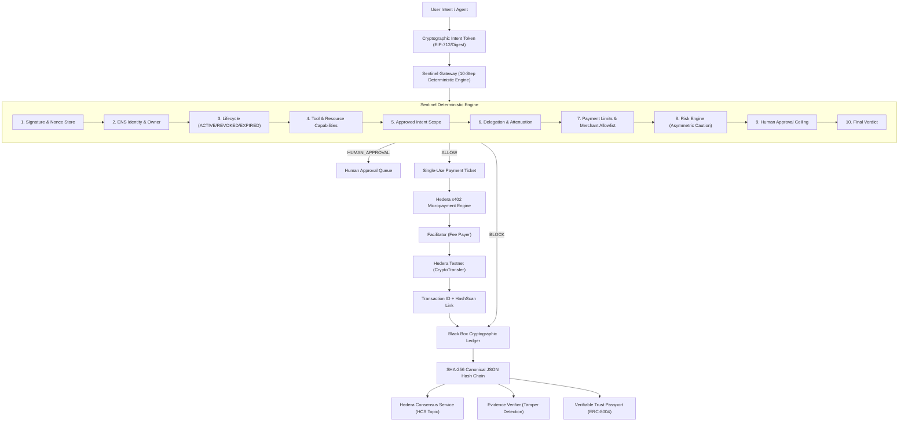

# MORTAL 2.0 — System Architecture Document

## 1. System Overview

MORTAL 2.0 provides an immutable accountability and security infrastructure for autonomous AI agents. It positions a deterministic authorization gateway (**Sentinel**) between autonomous agents and sensitive actions (financial transfers, file modifications, tool execution, delegation), backed by an immutable cryptographic audit ledger (**Black Box**) anchored to the **Hedera Consensus Service (HCS)**.



---

## 2. Core Invariants

1. **Independent Enforcement**: Every sensitive action passes through Sentinel. The backend enforces authorization independently. A frontend decision or LLM output can never override a deterministic denial.
2. **Payment Barrier**: The payment adapter is unreachable except through a gateway-issued, single-use, short-lived authorization ticket.
3. **Audit Ledger Invariant**: Every decision (ALLOW, BLOCK, HUMAN_APPROVAL) is immutably recorded in the Black Box hash chain:
   $$H_n = \text{SHA-256}(H_{n-1} \parallel \text{CanonicalJSON}(R_n))$$
4. **Mandatory Wording Rule**: Hashing proves records have not changed since commitment. It does not prove the original data was truthful.
5. **Delegation Attenuation**: A delegated child agent's capabilities are strictly a subset of its parent agent ($C_{\text{child}} \subseteq C_{\text{parent}}$). Parent revocation immediately cascades to all child agents.

---

## 3. Sentinel 10-Step Deterministic Pipeline

Sentinel evaluates every action proposal in this exact order. Any failure returns `BLOCK`:

| Step | Engine Component | Invariant Checked | Failure Code |
|---|---|---|---|
| **1** | `IntentValidator` | Signature valid, timestamp within window, nonce not replayed | `AUTH_SIGNATURE_INVALID`, `NONCE_REPLAYED` |
| **2** | `EnsIdentityManager` | Resolves on Sepolia NameWrapper/PublicResolver; owner matches signer | `ENS_RESOLUTION_FAILED`, `OWNER_MISMATCH` |
| **3** | `EnsIdentityManager` | Lifecycle status is ACTIVE; not revoked; not expired | `AGENT_REVOKED`, `AGENT_EXPIRED`, `AGENT_INACTIVE` |
| **4** | `CapabilityManager` | Tool is in policy allowed tools; target resource matches permitted URIs | `TOOL_NOT_PERMITTED`, `RESOURCE_NOT_PERMITTED` |
| **5** | `IntentValidator` | Proposed tool parameters align with approved user intent | `ACTION_OUTSIDE_APPROVED_INTENT` |
| **6** | `DelegationManager` | Child scope $\subseteq$ parent scope; depth $\le 2$; parent active | `CHILD_SCOPE_EXCEEDS_PARENT`, `DELEGATION_DEPTH_EXCEEDED`, `PARENT_AGENT_REVOKED` |
| **7** | `PolicyEngine` | Destination in merchant allowlist; amount $\le$ ₹5,000 (50 HBAR); within period limit | `DEST_NOT_ALLOWLISTED`, `OVER_LIMIT`, `PERIOD_SPENDING_LIMIT_EXCEEDED` |
| **8** | `RiskEngine` | Rule-based anomaly detection (prompt injection, off-pattern spending) | `RISK_ANOMALY_DETECTED` (elevates ALLOW $\to$ HUMAN_APPROVAL) |
| **9** | `PolicyEngine` | Amount $>$ configurable approval ceiling (₹2,000 / 20 HBAR) | `APPROVAL_REQUIRED_AMOUNT_THRESHOLD` $\to$ `HUMAN_APPROVAL` |
| **10** | `SentinelGateway` | All checks passed; issue single-use payment ticket | `POLICY_PASSED_ALLOW` $\to$ `ALLOW` |

---

## 4. Track A: ENSv2 Agent Identity

### Contract Interface & Network
- **Network**: Ethereum Sepolia Testnet.
- **Contracts**:
  - NameWrapper: `0xab50971078225D365994dc1Edcb9b7FD72Bb4862`
  - PublicResolver: `0x6925affDa98274FE0376250187CCC4aC62866dCd`
- **Metadata Text Record Schema**:
  - `agent.id`: Cryptographic identifier (`agent_<hex>`)
  - `agent.role`: Textual designation (`Autonomous Procurement Agent`)
  - `agent.status`: Lifecycle state (`ACTIVE` / `REVOKED` / `EXPIRED`)
  - `agent.expiry`: Unix epoch expiration timestamp
  - `agent.owner`: Controller EVM address
  - `agent.capabilities`: JSON serialized array of permitted capabilities
- **Permission Rejection**: Only the registered owner address or parent registrar may update text records or subname configurations. Unauthorized update attempts throw deterministic permission rejection errors (`UNAUTHORIZED_UPDATE`).

---

## 5. Track B: Hedera x402 Micropayments & HCS

### HTTP 402 Protocol Flow
1. Client requests protected vendor resource `/api/vendor/procurement-service`.
2. Vendor server returns HTTP `402 Payment Required` with `PAYMENT-REQUIRED` header:
   ```json
   {
     "scheme": "exact",
     "network": "hedera:testnet",
     "amount": "500000000",
     "asset": "0.0.0",
     "payTo": "0.0.567890",
     "extra": {
       "feePayer": "0.0.123456",
       "demoAmount": 500,
       "demoCurrency": "DEMO_INR"
     }
   }
   ```
3. Agent requests authorization from SentinelGateway.
4. Sentinel verifies all 10 policy checks. If `ALLOW`, it issues `authorizedPaymentTicket`.
5. Agent packages Hedera `TransferTransaction`, signs transaction bytes, attaches ticket, and submits to Facilitator.
6. Facilitator atomically verifies and consumes the single-use ticket in SQLite, co-signs as fee-payer sponsoring network gas, and broadcasts to Hedera testnet.
7. Receipt records transaction ID (e.g. `0.0.123456@1793905909.795967308`) and HashScan explorer link (`https://hashscan.io/testnet/transaction/...`).

### Hedera Consensus Service (HCS) Topic Anchoring
- **Topic Memo**: `MORTAL-2.0-Audit-Ledger`
- **Topic ID**: `0.0.889900`
- Chain head hash is anchored periodically and on every incident.
- Receipt contains topic ID, sequence number, and consensus timestamp (`<seconds>.<nanos>`).

---

## 6. Black Box Hash Chain & Evidence Verifier

### SHA-256 Canonical Hash Chain
Each event $R_n$ is deterministically serialized with lexicographically sorted keys. The record hash is:
$$H_n = \text{SHA-256}(H_{n-1} \parallel \text{CanonicalJSON}(R_n))$$

### Tamper Detection Algorithm
The `EvidenceVerifier` executes a full linear sweep from sequence #1 to head:
1. Re-verifies $R_n.\text{prevHash} == H_{n-1}$.
2. Re-computes $\text{SHA-256}(H_{n-1} \parallel \text{CanonicalJSON}(R_n))$ and compares against $R_n.\text{hash}$.
3. If an adversary edits a database record, the recomputed hash diverges immediately at the altered record, pinpointing the exact `sequenceNumber`, `eventId`, and discrepancy type (`HASH_MISMATCH` or `PREV_HASH_BROKEN`).
4. Compares head hash with HCS consensus anchor commitment.
